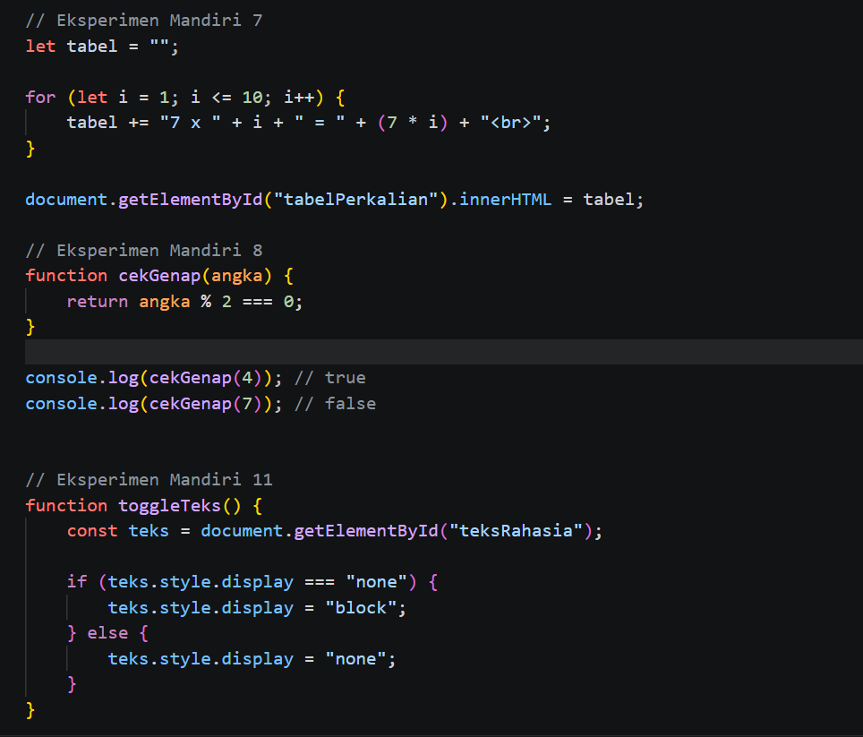

# Praktikum JavaScript

## Pertanyaan dan Tugas
1. Jelaskan perbedaan `console.log()`, `alert()`, `prompt()`, dan `textContent`/`innerHTML`.
2. Apa perbedaan `let` dan `const`? Berikan contoh.
3. Apa perbedaan operator `==` dan `===`?
4. Jelaskan fungsi `if-else` dan `switch`. Kapan masing-masing dapat digunakan?
5. Apa fungsi parameter dan `return` dalam function?
6. Bagaimana JavaScript memilih elemen HTML menggunakan `document.getElementById()`?
7. Buat script untuk memvalidasi form agar nama tidak kosong dan nilai berada pada rentang 0–100.

## Jawaban

### 1. Perbedaan `console.log()`, `alert()`, `prompt()`, dan `textContent`/`innerHTML`
- `console.log()` menampilkan informasi di console browser.
- `alert()` menampilkan pesan popup ke pengguna.
- `prompt()` meminta input dari pengguna.
- `textContent` menampilkan teks plain di elemen HTML.
- `innerHTML` menampilkan isi HTML yang bisa berisi tag seperti `<b>teks</b>`.

### 2. Perbedaan `let` dan `const`
`let` digunakan untuk variabel yang nilainya bisa berubah, sedangkan `const` digunakan untuk variabel yang nilainya tidak bisa diubah setelah ditetapkan.

```js
let umur = 18;
umur = 19;

const nama = "Billa";
// nama = "Siti"; // akan error
```

### 3. Perbedaan `==` dan `===`
- `==` membandingkan nilai saja.
- `===` membandingkan nilai dan tipe data.

```js
console.log(5 == "5");   // true
console.log(5 === "5");  // false
```

### 4. Fungsi `if-else` dan `switch`
`if-else` digunakan untuk mengecek kondisi yang lebih kompleks, sedangkan `switch` digunakan ketika kita ingin memilih tindakan berdasarkan nilai tertentu.

```js
let nilai = 80;

if (nilai >= 75) {
  console.log("Lulus");
} else {
  console.log("Tidak lulus");
}

switch (nilai) {
  case 80:
    console.log("Nilai bagus");
    break;
  default:
    console.log("Nilai lain");
}
```

### 5. Fungsi parameter dan `return`
- Parameter adalah nilai yang diterima oleh function saat function dipanggil.
- `return` adalah hasil yang dikembalikan oleh function.

```js
function tambah(a, b) {
  return a + b;
}

console.log(tambah(3, 5)); // 8
```

### 6. Menggunakan `document.getElementById()`
Digunakan untuk memilih elemen HTML berdasarkan ID-nya.

```js
document.getElementById("pesan").textContent = "Halo!";
```

### 7. Script validasi form
Berikut contoh form HTML dan JavaScript untuk validasi nama dan nilai 0–100.

```html
<input type="text" id="nama" placeholder="Masukkan nama">
<input type="number" id="nilai" placeholder="Masukkan nilai">
<button onclick="validasi()">Periksa</button>
<p id="hasil"></p>
```

```js
function validasi() {
  const nama = document.getElementById("nama").value.trim();
  const nilai = document.getElementById("nilai").value;
  const hasil = document.getElementById("hasil");

  if (nama === "") {
    hasil.textContent = "Nama tidak boleh kosong";
  } else if (nilai === "" || Number(nilai) < 0 || Number(nilai) > 100) {
    hasil.textContent = "Nilai harus berada pada rentang 0–100";
  } else {
    hasil.textContent = "Data valid";
  }
}
```

Catatan: Pastikan file HTML dan JavaScript terhubung dengan benar agar script dapat berjalan.


Sreenshot (index.html)

# Pengenalan JavaScript dan Cek Bilangan


# Ubah Warna dan Daftar Menu Makanan


# Mini Project dan Eksperimen Mandiri


Sreenshot (script.js)
# Hello World, Prompt, dan Operasi Dasar


# Validasi Nilai, Switch, Cek Bilangan, dan Warna


# Daftar Menu dan Mini Project


# Eksperimen Mandiri Nomor 7, 8, dan 11


hasil tampilan di web


